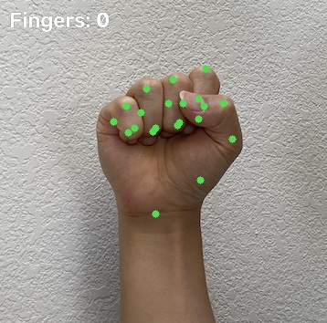
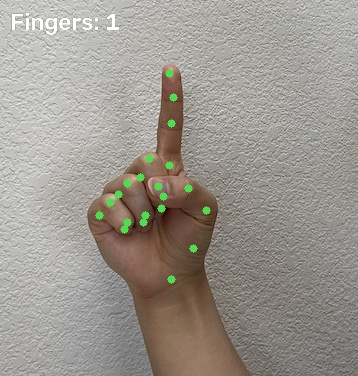
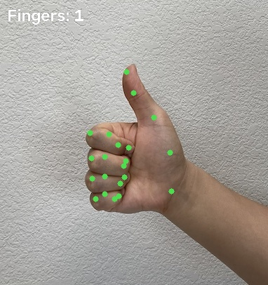
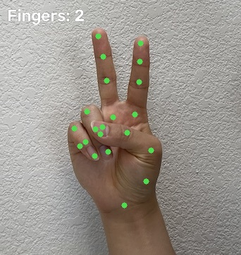
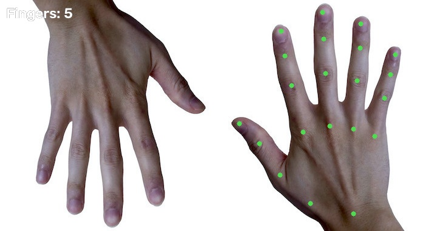
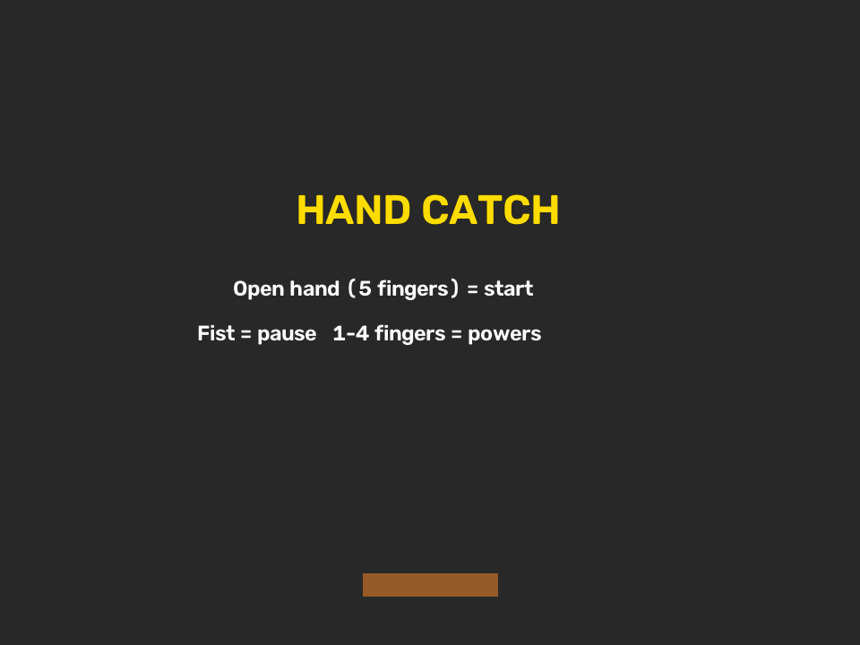
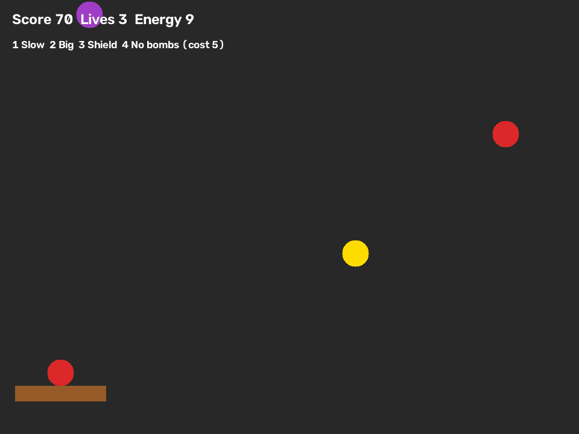
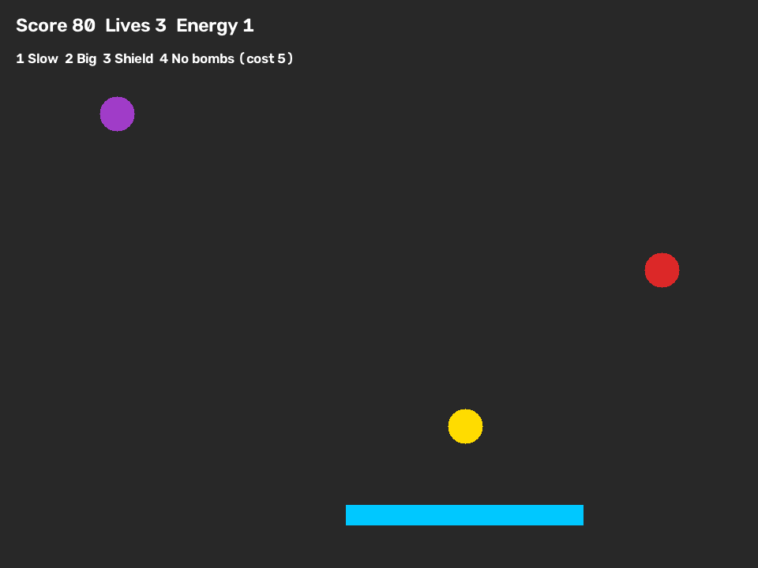
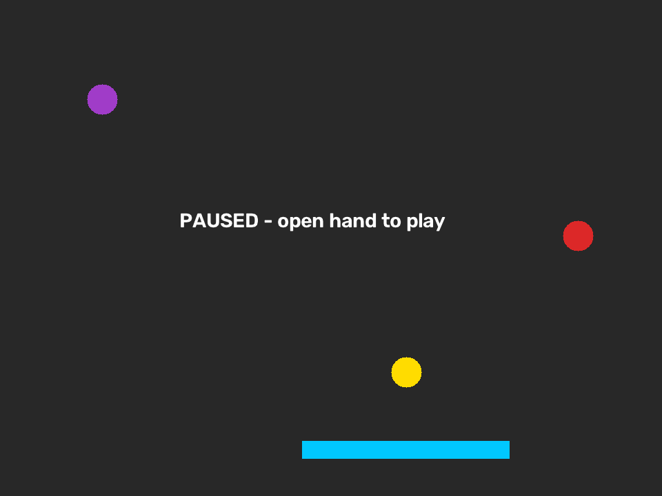
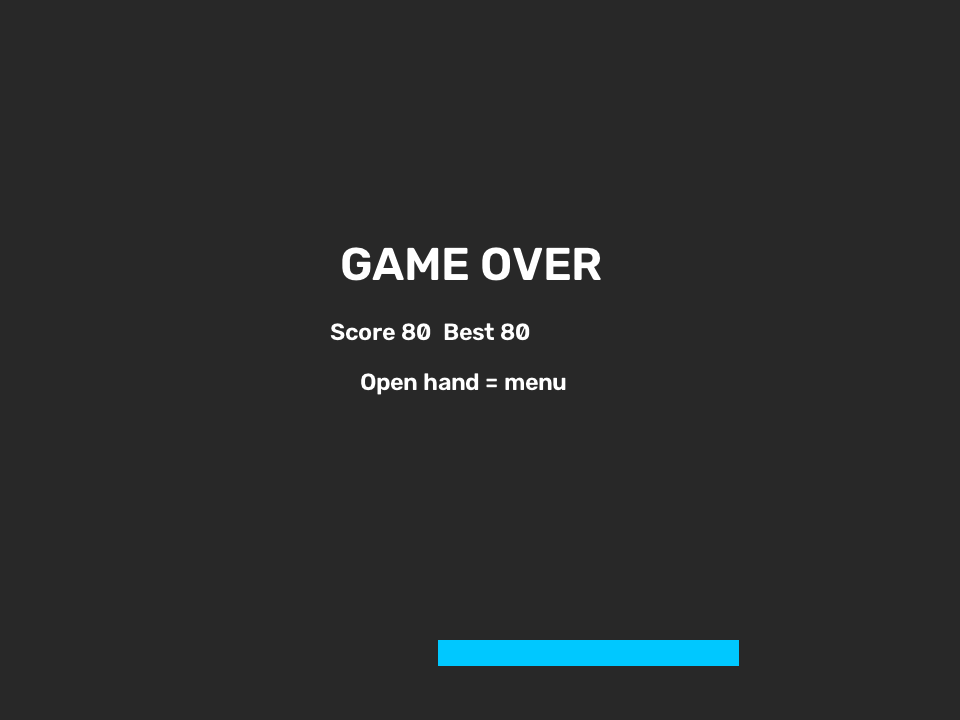

# 1. Ý tưởng và mục tiêu

**Hand Catch** là trò chơi "hứng đồ" điều khiển hoàn toàn bằng bàn tay qua webcam,
không cần bàn phím hay chuột. Trái cây, ngôi sao và bom rơi từ trên xuống. Người chơi
đưa tay sang trái/phải để di chuyển cái giỏ ở đáy màn hình: hứng trái cây và ngôi sao
để ghi điểm, tránh bom. Số ngón tay giơ lên được dùng làm lệnh: xoè tay để bắt đầu,
nắm tay để tạm dừng, giơ 1–4 ngón để dùng 4 kỹ năng.

Mục tiêu:

- Dùng MediaPipe Hand để lấy vị trí bàn tay từ camera theo thời gian thực.
- Tự xây dựng các thuật toán đơn giản, dễ giải thích: cho giỏ đi theo tay, đếm số
  ngón tay, chống nhận nhầm cử chỉ, kiểm tra hứng trúng, tính điểm, mạng, level và
  kỹ năng.

# 2. Input và Output

| | Mô tả |
|---|---|
| **Input** | Ảnh từ webcam, mỗi frame được đổi về 960×720 và lật gương. |
| **Dữ liệu trung gian** | 21 điểm (x, y) trên bàn tay do MediaPipe trả về. |
| **Output** | Giỏ di chuyển theo tay; đồ vật rơi; điểm, mạng, năng lượng; trạng thái game (Menu, Đang chơi, Tạm dừng, Kết thúc); các chấm trên bàn tay và số ngón đang giơ hiện trên màn hình. |

Mỗi frame chương trình làm các bước sau:

```
Camera
  ↓
MediaPipe: 21 điểm trên bàn tay
  ↓
Thuật toán của em:
  • điểm số 9   → vị trí giỏ
  • đếm số ngón → lệnh / kỹ năng
  ↓
Game: đồ rơi, hứng, điểm, mạng
  ↓
Vẽ lên màn hình
```

# 3. Chức năng MediaPipe được sử dụng

Ứng dụng dùng **MediaPipe Hand Landmarker** (MediaPipe Tasks API, file model
`hand_landmarker.task`), tìm tối đa 1 bàn tay mỗi ảnh. Với bàn tay tìm được,
MediaPipe trả về 21 điểm. Mỗi điểm có toạ độ `x, y` trong khoảng [0, 1]; chương
trình nhân với kích thước ảnh để đổi ra pixel.

```
        8   12  16  20      ← đầu ngón
        7   11  15  19
   4    6   10  14  18      ← khớp giữa ngón
   3    5    9  13  17      ← gốc ngón
   2
   1
            0               ← cổ tay
```

MediaPipe chỉ cho biết **vị trí** các điểm. Việc hiểu các điểm đó (tay ở đâu, giơ mấy
ngón, có hứng được đồ không) do chương trình tự làm.

# 4. Thuật toán và logic xử lý

## 4.1. Giỏ đi theo tay

Vị trí tay là toạ độ x của **điểm số 9** (gốc ngón giữa, nằm giữa lòng bàn tay).
Điểm này gần như đứng yên khi người chơi co hay duỗi ngón, nên giỏ không bị giật khi
nắm tay để tạm dừng.

Các điểm MediaPipe trả về hơi dao động giữa các frame. Để giỏ không rung, mỗi frame
giỏ chỉ đi **1/3 quãng đường** từ vị trí hiện tại tới tay:

```python
basket_x += (hand_x - basket_x) / 3
```

Sau đó giỏ được giữ trong màn hình (không cho ra ngoài mép trái/phải).

## 4.2. Đếm số ngón tay

Quan sát: **ngón duỗi thì đầu ngón ở xa cổ tay; ngón co thì đầu ngón gập về gần cổ
tay**. Vì vậy, với 4 ngón dài:

> Ngón đang giơ ⇔ khoảng cách (đầu ngón → cổ tay) > khoảng cách (khớp giữa ngón → cổ tay)

| Ngón | Đầu ngón | Khớp giữa |
|---|---|---|
| Trỏ | 8 | 6 |
| Giữa | 12 | 10 |
| Áp út | 16 | 14 |
| Út | 20 | 18 |

Ngón cái gập ngang qua lòng bàn tay chứ không gập về cổ tay, nên dùng gốc ngón út
(điểm 17) làm mốc: ngón cái đang giơ khi đầu ngón cái (4) xa điểm 17 hơn khớp ngón
cái (3).

Khoảng cách tính bằng công thức Pythagore: `distance = √((x1 − x2)² + (y1 − y2)²)`.
Vì so sánh khoảng cách chứ không so "cao hơn/thấp hơn", cách đếm vẫn đúng khi bàn
tay nghiêng.

Kết quả là một số từ 0 đến 5.

## 4.3. Chống nhận nhầm: phải giữ yên mới tính

Khi tay đang di chuyển nhanh, số ngón đếm được có thể sai trong 1–2 frame. Vì vậy
chương trình đếm xem **cùng một số ngón được thấy bao nhiêu frame liên tiếp**:

- Nếu số ngón giống frame trước: tăng bộ đếm thêm 1.
- Nếu khác: đặt lại bộ đếm về 1.
- Khi bộ đếm đúng bằng **15** (khoảng 0.5 giây): thực hiện lệnh **một lần**.

Vì chỉ làm khi bộ đếm *bằng* 15, giữ nguyên tay lâu hơn cũng không bị lặp lệnh.

Cũng bộ đếm đó: nếu **không thấy tay 45 frame liên tiếp** (khoảng 1.5 giây) khi đang
chơi, game tự tạm dừng để người chơi không bị mất mạng oan.

## 4.4. Các trạng thái của game

| Đang ở | Số ngón | Chuyển sang |
|---|---|---|
| MENU | 5 | PLAY (ván mới) |
| PLAY | 0 | PAUSE |
| PLAY | 1–4 | dùng kỹ năng (mục 4.7) |
| PAUSE | 0 hoặc 5 | PLAY |
| OVER | 5 | MENU |

Khi hết mạng hoặc đạt 1500 điểm, game chuyển sang OVER (thua hoặc thắng).

## 4.5. Đồ rơi và độ khó

- `level = điểm // 300 + 1`.
- Cứ mỗi `max(12, 36 − 3 × level)` frame thì thêm một món đồ ở vị trí x ngẫu nhiên.
- Loại đồ chọn ngẫu nhiên: 20% bom, 7% sao, 73% trái cây.
- Mỗi frame, mỗi món đồ rơi xuống `5 + level` pixel.

Điểm càng cao thì đồ rơi càng nhanh và càng dày.

## 4.6. Kiểm tra hứng trúng, tính điểm và mạng

Khi một món đồ rơi tới độ cao của giỏ, chương trình kiểm tra nó có nằm trong bề ngang
của giỏ không:

```python
if abs(thing["x"] - basket_x) <= half:   # half = nửa bề ngang giỏ
```

| Sự kiện | Kết quả |
|---|---|
| Hứng trái cây | +10 điểm, +1 năng lượng |
| Hứng ngôi sao | +50 điểm, +3 năng lượng |
| Hứng bom | −1 mạng |
| Để rơi trái cây | −1 mạng |
| Để rơi sao hoặc bom | không sao |

Người chơi có 3 mạng. Thắng khi đạt 1500 điểm, thua khi hết mạng. Điểm cao nhất được
giữ lại giữa các ván.

## 4.7. Kỹ năng bằng số ngón tay

Mỗi kỹ năng tốn **5 năng lượng** (năng lượng bắt đầu là 4, tối đa 10). Không đủ năng
lượng thì kỹ năng không bật.

| Số ngón | Kỹ năng | Cách làm |
|---|---|---|
| 1 | Làm chậm | Tốc độ rơi chia đôi trong 150 frame (~5 giây) |
| 2 | Giỏ to | Bề ngang giỏ nhân đôi trong 180 frame (~6 giây) |
| 3 | Khiên | Bật một biến `shield = True`. Khi sắp mất mạng, nếu khiên đang bật thì tắt khiên thay vì trừ mạng. Giỏ đổi sang màu xanh khi có khiên. |
| 4 | Xoá bom | Bỏ mọi món đồ loại bom ra khỏi danh sách đồ đang rơi |

# 5. Chuyển dữ liệu MediaPipe thành hành động trong game

| Dữ liệu từ MediaPipe | Xử lý | Hành động trong game |
|---|---|---|
| Điểm số 9 | Giỏ đi 1/3 quãng đường tới tay | Giỏ di chuyển ngang |
| 21 điểm | Đếm số ngón (0–5) → giữ đủ 15 frame | Bắt đầu, tạm dừng, chơi tiếp, kỹ năng 1–4 |
| Không có tay 45 frame | Đếm frame | Tự tạm dừng |
| Vị trí giỏ và đồ vật | Đồ có nằm trong bề ngang giỏ không | Cộng điểm / trừ mạng |

# 6. Cấu trúc chương trình

| File | Vai trò |
|---|---|
| `main.py` | Vòng lặp chính: đọc camera → tìm tay → đếm ngón → cập nhật game → vẽ |
| `hand.py` | Gọi MediaPipe lấy 21 điểm; hàm `count_fingers()` đếm số ngón |
| `game.py` | Lớp `Game`: luật chơi, không phụ thuộc camera |
| `test_game.py` | 13 bài kiểm tra tự động |

Phần luật chơi chỉ nhận vào 2 thứ mỗi frame: **số ngón tay** và **vị trí x của tay**.
Vì không dính tới camera, có thể kiểm tra luật chơi tự động mà không cần webcam.

# 7. Kết quả thực nghiệm

## 7.1. Đếm ngón trên ảnh tay thật

Chạy MediaPipe và hàm `count_fingers()` trên 5 ảnh bàn tay mẫu:

| Ảnh | Số ngón đếm được | Đúng? |
|---|---|---|
| Nắm tay | 0 | ✓ |
| Chỉ ngón trỏ | 1 | ✓ |
| Giơ ngón cái | 1 | ✓ |
| Chữ V | 2 | ✓ |
| Xoè bàn tay | 5 | ✓ |

{width=19%}
{width=19%}
{width=19%}
{width=19%}

{width=60%}

## 7.2. Kiểm tra tự động

13 bài kiểm tra (`python -m unittest test_game`) đều đạt:

- Đếm đúng 0, 1, 2, 3, 4, 5 ngón trên bàn tay giả lập.
- Xoè tay bắt đầu game; chưa giữ đủ 15 frame thì chưa tính.
- Nắm tay tạm dừng, xoè tay chơi tiếp; mất tay 45 frame thì tự tạm dừng.
- Hứng quả +10, hứng sao +50; để rơi quả mất mạng; né bom không sao, hứng bom mất mạng.
- Không đủ năng lượng thì kỹ năng không bật; làm chậm làm đồ rơi đúng một nửa; giỏ
  to rộng gấp đôi; khiên đỡ đúng 1 lần; xoá bom giữ lại trái cây.
- Đủ 1500 điểm thì thắng, hết mạng thì thua.

## 7.3. Hình ảnh giao diện

{width=48%}
{width=48%}

{width=48%}
{width=48%}

{width=48%}

# 8. Khó khăn và hướng phát triển

**Khó khăn và cách giải quyết:**

- *Giỏ bị rung* vì các điểm hơi dao động → giỏ chỉ đi 1/3 quãng đường mỗi frame.
- *Tạm dừng nhầm khi vẫy tay nhanh* → phải thấy cùng số ngón 15 frame liên tiếp.
- *Nắm tay làm giỏ giật* nếu dùng đầu ngón trỏ → dùng điểm 9 ở giữa lòng bàn tay.
- *Đếm sai ngón cái* nếu so với cổ tay → so với gốc ngón út.
- *Mất tay khỏi camera làm mất mạng oan* → tự tạm dừng sau 45 frame không thấy tay.

**Hướng phát triển:**

- Chơi 2 người, mỗi người một tay, mỗi tay một giỏ.
- Thêm âm thanh, hình ảnh đẹp hơn cho đồ vật.
- Lưu bảng điểm cao vào file.

# 9. Demo và mã nguồn

- Mã nguồn: ............ (link GitHub)
- Video demo: ............
